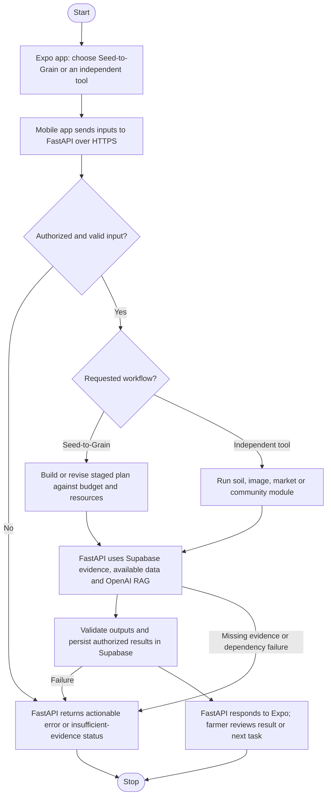

# Recommended application flow

The Android/iOS app offers a guided farming journey and independent tools; neither entry requires using the other. FastAPI handles evidence retrieval, calculations, external APIs and persistence, then returns results to the phone. Before runtime, reviewed agricultural guidance is summarized, tagged and indexed; community reports enter a separate verification process rather than becoming authoritative guidance.

## Recommendation and confirmed scope

**Topic: AI-powered agricultural assistance from seed selection to grain selling, with independent analysis tools and location-based community alerts.** Preserve the user's distinction: Seed-to-Grain is a persistent, step-by-step workflow; soil, crop images, grain images, price forecasting, mandi comparison and community are separately accessible. Shared infrastructure does not merge their user journeys. Import a tool result into a farm plan only after farmer confirmation.

**Confirmed:** ten-hour hackathon; Expo React Native for Android/iOS, demonstrated using Expo Go; full product vision above. **Assumed:** India because mandis are specified, four generalist developers, existing OpenAI key, no proprietary datasets/hardware. Crop, region, team skills and official rubric remain unknown. The project initially contained no application assets; only research exists. This supersedes the earlier tomato-only recommendation.

The proposed differentiator is a **budget- and resource-feasible plan that explains changes**, supported by independently useful tools. Broad feature coverage alone is not novel. The full production product exceeds ten hours; demonstrate its structure with a complete bounded journey and honest capability states.

## Problem, evidence and outcome

**Problem hypothesis:** farmers coordinating seed purchases, cultivation and selling across separate information sources can receive mutually inconsistent advice when budget, water, crop stage and local conditions differ. This can cause unnecessary expenditure or missed actions; local frequency and financial loss have not been measured. Farmers are users/beneficiaries; an FPO/cooperative is a plausible buyer/operator. Nearby landholders can also be affected by community reports and pesticide activity.

India's Soil Health Card covers **12 measured parameters** and fertilizer recommendations: soil interpretation should use test values, not infer nutrients from a photograph. [PIB, 18 February 2025](https://www.pib.gov.in/newsite/erelcontent.aspx?lang=2&reg=48&relid=267668) Regional cultivation packages already cover seed-to-harvest stages, but applicability varies by region and growing conditions. [Meghalaya rice package](https://megagriculture.gov.in/public/package_of_practice_rice.aspx)

Image performance cannot be assumed from laboratory benchmarks. Mohanty et al. reported **99.35%** on held-out controlled PlantVillage images, versus **31.40%/31.69%** on two small external sets of 121/119 images across 38 classes. This 2016 result illustrates domain shift; it does not measure current OpenAI models. [Original paper](https://www.frontiersin.org/journals/plant-science/articles/10.3389/fpls.2016.01419/full)

**Primary prototype outcome:** proportion of independently reviewed farm scenarios producing an actionable, evidence-supported plan within declared constraints. Target ≥85%, with zero silently violated hard constraints. Track citation support, abstentions, completion time and projected versus actual costs. Yield, pesticide reduction and income improvement require later field evaluation.

## Product modules and honest capability boundaries

| Module | Intended behavior | Evidence/input needed; ten-hour treatment |
|---|---|---|
| Seed-to-Grain | Land/resource assessment → feasible seed options → preparation/sowing → nutrition/water/weather tasks → harvest/storage → selling checklist | Region-specific protocol, area, season, budget, irrigation capacity, local input quotes, soil report; implement one supported crop-region profile |
| Soil analysis | Interpret test values and crop suitability constraints | Manual Soil Health Card/lab values, units and sample date; missing values stay unknown |
| Crop quality images | Describe visible symptoms and suggest inspection questions | Photo plus crop/stage/history; provisional triage, not certified diagnosis or yield prediction |
| Grain price prediction | Forecast a specified commodity/variety/market/horizon with uncertainty | Consistent historical series and chronological backtesting; unavailable until data/model gate passes |
| Mandi comparison | Compare like-for-like reported prices and estimated net proceeds | Dated market records, units, grade and farmer-entered transport/fees; verified snapshot fallback |
| Grain identification | Suggest grain type and visible defects | Bounded supported classes, reference images, rejection of unknowns; cannot certify moisture, residues or contamination |
| Community | Report nearby pests, symptoms and pesticide applications; show relevant alerts | Location consent, crop, time, evidence, verification state; in-app feed during Expo Go demo |

A farmer can use any tool without enrolling a farm in Seed-to-Grain. A plan stores completed actions, remaining budget, assumptions, evidence versions and next tasks. Forecasts cover their documented horizon; the full-season plan must not imply full-season weather certainty.

## Existing projects and mechanism choices

Inspected official product pages, a public hackathon README and original research. Documented features are not tested capabilities; source/API access is not established by a product's existence.

| Existing project | Purpose/status and verified stack | Limitation/opportunity; reuse/license |
|---|---|---|
| [Plantix](https://plantix.net/en/download/) | Commercial Android app documents image diagnosis, fertilizer calculator, crop-cycle guidance, community and disease alerts; internal stack undisclosed | Substantial overlap. Test explicit resource constraints and explainable plan revisions; no product code/license assumed reusable |
| [DeHaat](https://agrevolution.in/company) | Commercial end-to-end inputs, advisory and output ecosystem; vendor reports 1.8m+ farmers; internal stack undisclosed | End-to-end scope already exists. Proposed software demo avoids reliance on a physical service network; proprietary |
| [eNAM/AGMARKNET dashboard](https://www.enam.gov.in/web/dashboard/Agm_Enam_ctrl) | Government market-price comparison; min/modal/max and commodity/market filters documented in indexed official page; dynamic records not retrieved | Price discovery exists. Add transparent user-entered cost deductions, without claiming realized sale prices; API/export access pending |
| [PerishNet](https://github.com/rohann-sagar/PerishNet) | Public SIH 2026 development README proposes vision/sensors, FastAPI, React and PostgreSQL | Outcome predictions and sensing exceed available evidence; deferred license means no code reuse. Relevant negative scope example |

Six candidate mechanisms within the requested vision:

| Mechanism | Benefit/difference; assumption | Decisive experiment; disposition |
|---|---|---|
| Static sourced calendar | Conventional baseline; assumes conditions stay fixed | Review same scenarios; retain as comparator |
| Constraint-aware plan revisions | Preserve feasibility as budget/resources change; assumes usable local protocols/quotes | Lower budget or remove water supply; reject incompatible plan; **selected** |
| Net mandi proceeds | Incorporate explicit costs rather than ranking price alone; assumes comparable records | Higher headline price loses after costs; second priority |
| Local report verification | Separate observation from confirmed outbreak; assumes moderation capacity | Duplicates/unverified reports cannot imply confirmation; demo bounded states |
| Image-to-exact-quality grading | Potential rapid assessment; lacks calibrated labels and physical measurements | External-image validation; reject exact grading claim |
| Sensor-based farm digital twin | Continuous monitoring; assumes unavailable sensors/calibration | Physical ground-truth trial; future only |

Top-two causal chains: changing resources → recheck explicit constraints → revise tasks with reasons → fewer infeasible recommendations → perturbation test. Variable selling costs → compute comparable net proceeds → change ranking when justified → potentially better selling decisions → same-quote comparison. Both advantages remain hypotheses; neither establishes profit gains. Prefer the plan because it anchors the user's core workflow; use source calendar fallback if constraint handling fails.

## Technical blueprint

**Mobile:** Expo, React Native, TypeScript, Expo Router. Tabs: Home, Farm Plan, Tools, Community, Profile; separate Tools screens for every requested analysis. Use SDK-compatible dependencies installed through `npx expo install`; resolve and lock versions against installed Expo Go at kickoff. No application packages have been installed or tested.

ImagePicker and Location are included in Expo Go. Use camera/gallery selection and foreground location with manual district fallback. [ImagePicker](https://docs.expo.dev/versions/latest/sdk/imagepicker/), [Location](https://docs.expo.dev/versions/latest/sdk/location/). Android remote push notifications require a development build from SDK 53 onward; demo community alerts inside the app. Background geofencing and store releases are later development-build work. [Notifications](https://docs.expo.dev/versions/latest/sdk/notifications/)

**Planning logic:** reviewed templates define stages, prerequisites and permitted options. Deterministic calculations enforce area, quantities, cost and resource constraints; AI explains alternatives using retrieved evidence. Missing input prices produce incomplete cost estimates, never fabricated affordability. Nutrient recommendations require crop/local soil context; distinguish nutrient amounts from fertilizer-product mass. Water requirements depend on crop stage, effective rainfall, soil water balance and system losses; irrigation method alone is insufficient. FAO's standard-condition relationship is `ETc = Kc × ETo`; paddy additionally needs appropriate field-water accounting. [FAO 56, chapter 6](https://www.fao.org/4/x0490e/x0490e0b.htm)

**Community:** store report type, crop, observation time, approximate public location, evidence and status: reported/reviewed/confirmed/rejected. Filter by configurable radius, crop relevance and recency; radius is a demo setting, not a disease-spread model. Duplicate reports are not independent confirmation. Reported pesticide use is historical observation, not endorsement. Product/formulation, crop/pest applicability, precautions and intervals require current reviewed label evidence. NHB guidance supports crop-appropriate registered products and following labels; a checklist is not a current registration database. [NHB checklist](https://nhb.gov.in/pdf/Self%20Assessment%20Checklist%20with%20Questions.pdf) PPQS access returned 403; automatic pesticide suitability therefore remains gated. Protect exact farm coordinates and require consent before sharing.

**Market logic:** retain date, source, market, commodity, variety, grade and units. Estimate net proceeds as comparable price × quantity minus entered transport/handling/fees. Display unknown costs and stale/missing quotes. Forecasting is separate: start with last-observation/seasonal-naive baselines; train only if a sufficiently complete historical series is acquired. Use rolling-origin MAE against identical held-out dates; shuffled splits leak future information. Today's price feed alone cannot support forecasting.

**Useful RAG:** prepare 20–30 original summaries/rule cards from approved crop-region guidance and soil interpretation material. Retain URL, publisher/date, section, crop, stage, region, units, reviewer and access scope. Review copyright/redistribution; avoid copying full source documents/images. Index in Supabase Postgres full-text search. Runtime: authorized query → metadata-filtered retrieval → at most four passages → OpenAI with facts and allowed actions → validate structured output/citations/numeric constraints → save/return. Missing/conflicting evidence returns an explicit no-answer state. Retrieved instructions cannot control the application. Re-review/re-index source updates. RAG explains image findings; it does not validate diagnosis or price forecasts.

### Stack, access and deployment

| Component | Selection/reason | Setup estimate; constraint/fallback |
|---|---|---|
| Mobile | Expo Go + React Native; shared Android/iOS code | 45–75 min; physical-device/SDK checks pending |
| Backend | Python 3.12, FastAPI, Pydantic, Uvicorn on Render | 45–75 min; pin smoke-tested packages; local labeled fallback |
| Data/auth/files/RAG | Hosted Supabase; relational plans, reports and evidence | 45–75 min; Firebase evaluated but SQL retrieval/audit joins favor Supabase |
| AI | OpenAI Responses, configurable `gpt-5.6-terra`; structured text/image input | 30–60 min; key assumed, permissions/credit unverified |
| Weather | Open-Meteo via backend, cached | 15–30 min; no-key noncommercial prototype; dated fixture on failure |
| Market data | Government data export/API where access verified | 30–60 min; activation/quota unknown; source-attributed dated CSV fallback |

Estimates overlap across four owners. Open-Meteo documents 600 calls/minute, 5,000/hour and 10,000/day for free noncommercial use; commercial service needs separate terms. [Pricing](https://open-meteo.com/en/pricing) Government mandi catalog retrieval failed (502/timeout); do not promise instant keys, live integration or historical coverage. [Catalog](https://data.gov.in/resource/current-daily-price-various-commodities-various-markets-mandi)

Supabase Free documents 500 MB database, 1 GB file storage, 5 GB egress, two active projects and inactivity pausing. Render Free documents 750 workspace instance-hours/month, idle sleep and ephemeral disk. Signup/card verification, available regions and account capacity remain untested. [Supabase](https://supabase.com/pricing), [Render](https://render.com/docs/free)

OpenAI text prices are $2/$12 per million input/output tokens: 2,000 input + 400 billed output tokens ≈$0.0088/call, before extra reasoning/retries. Image tokens add cost; log actual usage. Lexical retrieval needs no embedding/hosted-search charges. The app is not wholly free. [Model documentation](https://developers.openai.com/api/docs/models/gpt-5.6-terra)

API contracts: `POST /plans` accepts profile/resources/soil/quotes and returns versioned stages, costs, missing inputs and sources; `PATCH /plans/{id}` recomputes confirmed changes; `POST /tools/{tool}` returns typed result/evidence/limitations independently; `POST /reports` creates an unverified report; `GET /alerts` returns authorized relevant reports; `GET /healthz`. Use 422/401/403/503 and explicit unsupported/stale statuses. Multipart photos are bounded and type-checked.

FastAPI verifies Supabase identity/ownership; restrict row/file policies. Privileged keys stay server-side. Mobile config holds only a public HTTPS API base URL; phone `localhost` is not the laptop. Expo LAN/tunnel connectivity serves the mobile bundle, not automatically the backend. Test on physical Android and iOS; Expo's current instructions also require matching CLI/Go accounts on physical iOS. [Device workflow](https://docs.expo.dev/get-started/start-developing/)

Start with one backend process, estimated 512 MB RAM, under 20 MB seed data and five concurrent requests; no GPU. Persist outside the process, cap image sizes/concurrency and cache weather by area/time. If warm p95 exceeds 10 seconds, identify model/database/network bottlenecks before adding replicas. Index location/time queries; verify connection limits. Add image workers only after measured workload justifies them. [FastAPI deployment](https://fastapi.tiangolo.com/deployment/concepts/)

## Ten-hour build and proof

| Time | Owners/dependencies | Acceptance/cutoff |
|---|---|---|
| 0–1.5 h | Mobile lead, API lead, evidence/data owner, evaluator | Expo on phone → hosted API → Supabase save/read → one actual model response. Confirm both-device access; declare unavailable platforms honestly |
| 1.5–5.5 h | Mobile/API; reviewed crop template and input fixtures | Complete farm plan, budget change, independent soil interpretation, weather, dated mandi comparison and community report/feed |
| 5.5–8 h | Evidence/evaluation; integrated flow | Test constraints/citations/privacy/failures; add bounded image tools only if core passes; freeze at hour 8 |
| 8–10 h | Integration/presentation owners | Repair, rehearse, record actual latency/cost and source freshness |

**Must-build:** complete bounded planner plus independent soil/market/community flows. **Stretch:** crop/grain image triage and reviewed localization. **Future/research:** validated forecasting, certified grading, full crop coverage, push/geofencing. Unsupported modules remain visible with honest prerequisites, not fabricated results.

All following tests are pending: 12 independently labeled farm cases (≥85% supported feasible plans; zero hard-constraint violations); four missing/out-of-scope/restricted RAG cases (all abstain/deny correctly); every material generated claim supported by cited evidence; ten image examples including blur/unknown classes (no definitive unsupported classification); three market comparisons including stale/mismatched units; duplicate/unverified community reports cannot become confirmed alerts. If historical forecasts are attempted, beat naive MAE on chronological holdout or retain baseline. Without agronomist review these are documentary checks, not field validation.

Demo a resource-constrained plan, a reduced-budget revision with explained differences, then open a standalone tool without a plan. End with a community report and an unsupported-input failure. Label snapshots, accelerated season progression and simulated events explicitly.

## Impact, defense and uncertainties

Illustrative impact: 100 farmers × 40% adoption × ₹500 verified avoided cost/season = ₹20,000/season; all values are hypothetical. Measure net benefit after data-entry, advisory and service costs. FPO-assisted onboarding, local language, manual location and readable source cards support adoption; evaluated local protocols/outcome data could eventually provide defensibility.

Evaluator answers: **Why all-in-one?** Shared context with independent entry points. **Why AI?** Grounded interpretation/explanation; arithmetic/constraints remain deterministic. **Novelty?** Test constraint-aware revisions, not feature count. **Pesticide reliability?** Separate reports from reviewed suitability; no neighbor-to-prescription shortcut. **Proof of impact?** Prototype decision tests first; field outcomes later.

Attachment-priority self-assessment, not official marks: problem 12/15; innovation 14/25; feasibility 15/25 for bounded demo; actual readiness 0/20; impact 6/10; communication 3/5 = **50/100**, low confidence. Full production scope has lower ten-hour feasibility. Comparative mechanisms: static calendar 44/100 (less differentiation), net-price-first 48/100 (simpler, weaker fit to core vision), same zero-readiness basis. Official rubric absent.

Remaining blockers: crop-region protocol review, real account/model/device access, mandi data acquisition, historical price coverage and pesticide-label currency. No app, live API integration, forecast or agricultural outcome has been validated.

## Sources and evidence ledger

Accessed 23 October 2026. Undated means no reliable publication date shown. The earlier infrastructure research was reused; added research checked the user's expanded modules and Expo Go constraints. Facts are verified documentation unless access limits are stated; benefits and targets are explicitly unvalidated.

| Source/date | Claim supported | Limit/implication |
|---|---|---|
| [PIB Soil Health Cards](https://www.pib.gov.in/newsite/erelcontent.aspx?lang=2&reg=48&relid=267668), 18 Feb 2025 | Twelve soil parameters and recommendations | Measurements required; not a phone-soil model |
| [Meghalaya Agriculture rice practices](https://megagriculture.gov.in/public/package_of_practice_rice.aspx), undated | Region-specific stage guidance exists | Applicability/current chemical advice requires review |
| [Mohanty et al., Frontiers](https://www.frontiersin.org/journals/plant-science/articles/10.3389/fpls.2016.01419/full), 22 Sep 2016 | Controlled versus external image performance | Old models/small external samples; not current-model accuracy |
| [Plantix](https://plantix.net/en/download/), undated | Existing crop-cycle/image/community overlap | Vendor documentation, not independently tested |
| [DeHaat](https://agrevolution.in/company), undated | Commercial end-to-end service; vendor-reported reach | Proprietary; scale claims not impact proof |
| [eNAM dashboard](https://www.enam.gov.in/web/dashboard/Agm_Enam_ctrl), undated | Official indexed min/modal/max comparison | Dynamic record extraction failed |
| [Government mandi catalog](https://data.gov.in/resource/current-daily-price-various-commodities-various-markets-mandi), undated | Intended government price source | 502/timeout; account/quotas/history unverified |
| [PerishNet README](https://github.com/rohann-sagar/PerishNet), undated | Prior hackathon architecture and deferred license | Inspected in earlier research; runtime untested |
| [FAO 56 chapter 6](https://www.fao.org/4/x0490e/x0490e0b.htm), 1998 | Standard-condition ETc/Kc/ETo method | Local coefficients and water balance needed |
| [NHB Bharat GAP checklist](https://nhb.gov.in/pdf/Self%20Assessment%20Checklist%20with%20Questions.pdf), undated | Label/crop applicability and records | Not a live registration dataset |
| [PPQS major uses](https://ppqs.gov.in/divisions/cib-rc/major-uses-of-pesticides), inaccessible | Intended current pesticide evidence source | 403; no suitability claim relies on unseen content |
| [Open-Meteo docs](https://open-meteo.com/en/docs) and [pricing](https://open-meteo.com/en/pricing), current | Weather access/limits and commercial distinction | Forecast resolution/uncertainty; no runtime call tested |
| [Supabase pricing](https://supabase.com/pricing) and [full-text search](https://supabase.com/docs/guides/database/full-text-search), current | Managed capacity and retrieval | Own account/retrieval quality untested |
| [Firebase Firestore](https://firebase.google.com/docs/firestore), current | Managed document-store alternative | Earlier inspection; not selected |
| [Render limits](https://render.com/docs/free) and [FastAPI deployment](https://render.com/docs/deploy-fastapi), current | Hosting/access constraints and ASGI path | Provisioning untested |
| [FastAPI concepts](https://fastapi.tiangolo.com/deployment/concepts/), current | Process/memory/scaling considerations | Estimates are not capacity measurements |
| [OpenAI model](https://developers.openai.com/api/docs/models/gpt-5.6-terra) and [structured outputs](https://developers.openai.com/api/docs/guides/structured-outputs), current | Text/image input, API/output support, text prices | Own permissions, image cost and factual quality untested |
| [Expo ImagePicker](https://docs.expo.dev/versions/latest/sdk/imagepicker/) and [Location](https://docs.expo.dev/versions/latest/sdk/location/), current | Included-in-Go image selection and location | Native/background features have separate constraints |
| [Expo notifications](https://docs.expo.dev/versions/latest/sdk/notifications/), current | Android remote push needs development build | Use in-app feed for Go demo |
| [Expo development workflow](https://docs.expo.dev/get-started/start-developing/), current | QR/LAN/tunnel and current iOS account requirements | Both physical platforms still require testing |
